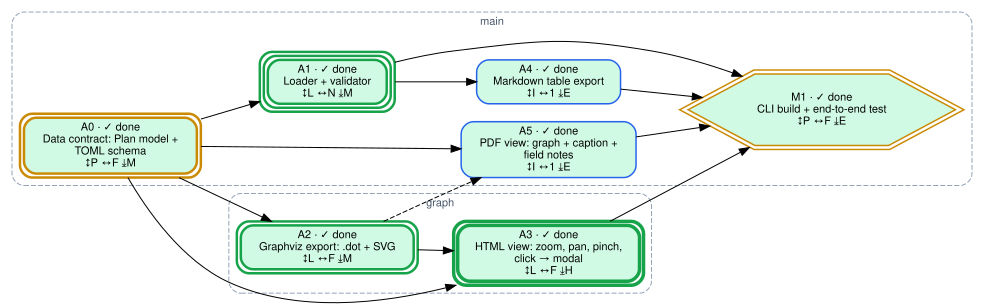

# Weaver

**Version 0.3 — under active development.**

Weaver turns a plan, written as a small TOML file, into views you can read and share:

| File | What it is |
|---|---|
| `PLAN.html` | One self-contained page: the graph with pan, zoom (wheel or pinch) and a details panel for every node. No external resources. |
| `PLAN.md` | A table of every node, a key, and field notes. This is the view GitHub renders. |
| `PLAN.pdf` | The graph, its caption, a key, and the field notes. |
| `plan.svg` | The graph alone. |

A plan is a dependency graph of work. Each node is an **atom** (a unit of work), a **merge** (where parallel strands come together) or a **release** (a merge where a version was cut). Each dependency is either a **build** seam (static: one node needs another's code) or a **runtime** seam (dynamic: one node needs another's output). Nodes run in **groups**, the parallel strands, and Weaver draws each group as a lane.

The plan format is the core of the project, and Weaver displays it. The example plan, [`examples/weaver_plan.toml`](examples/weaver_plan.toml), is the plan that built Weaver.

## What it looks like



Each node is a card: its id and status (`✓ done`), its title, and its codes. The fill shows the status, the border's colour and weight show complexity, the number of outlines shows amount, and the text colour shows scope. An amber `⚠` marks a node that shares a file with a node in another lane, with nothing ordering the two (see `files` below).

The page links to a node by its id: `PLAN.html#A3` opens the graph centred on `A3`, and the find box does the same.

The same plan as [Markdown](docs/example/PLAN.md) and as a [PDF](docs/example/PLAN.pdf). The interactive [`PLAN.html`](docs/example/PLAN.html) has to be downloaded and opened in a browser, because GitHub shows HTML files as source.

## Running it

```sh
python -m weaver build examples/weaver_plan.toml -o out/
```

Exit codes: `0` built · `1` the plan is invalid (every problem is listed, not just the first) · `2` wrong invocation or unreadable file · `3` with `--strict`, an overlap no `[[overlap]]` entry acknowledges (the views are still built).

Every overlap is printed as a warning, acknowledged or not.

**Requirements**

- Python 3.11 or newer (for `tomllib`).
- [Graphviz](https://graphviz.org/), with `dot` on the `PATH`.
- [WeasyPrint](https://weasyprint.org/), needed only for the PDF.

Tested with Python 3.12, Graphviz 2.43 and WeasyPrint 69.

## The plan format

An excerpt showing every field (nodes `A0`, `A1` and `A3` are defined elsewhere in the same file):

```toml
[plan]
schema = 3
title = "Ship the importer"
goal = "Customers can import a CSV and see their data."
caption = "Two parallel strands meet at M1."

[[node]]
id = "A2"
title = "Parse dates"
kind = "atom"
status = "doing"
group = "backend"
deps = ["A0"]
runtime_deps = ["A1"]
scope = "L"
amount = "F"
complexity = "M"
verify = "tests/test_dates.py"
decisions = ["D-3", "billing:D-12"]
files = ["importer/dates.py", "importer/schema.py"]
reworks = ["A1"]
notes = """
Free text, shown in the details panel and the field notes.
"""

[[overlap]]
file = "importer/schema.py"
nodes = ["A2", "A3"]
reason = "A3 only reads the column names"
```

### `[plan]`

| Field | | Meaning |
|---|---|---|
| `schema` | required | The format version: `1`, `2` (adds the `release` kind) or `3` (adds `files`, `reworks` and `[[overlap]]`). A plan without it, or with a version this Weaver does not know, is refused, never guessed at. |
| `title` | required | Non-empty. |
| `goal` | optional | What counts as done for the whole plan. |
| `caption` | optional | Shown under the graph: the words that make the diagram readable. |

Unknown keys are errors, so a typo fails loudly instead of being ignored.

### `[[node]]` (at least one)

| Field | | Meaning |
|---|---|---|
| `id` | required | Letters, digits, `_`, `.`, `-`. Unique within the plan. |
| `title` | required | Non-empty. |
| `kind` | `atom` | `atom`, `merge`, or `release` (schema 2): a merge that marks where a version was cut, drawn as an octagon with bold purple text. |
| `status` | `todo` | `todo`, `doing`, `done` or `blocked`. Drawn as the fill colour, and printed as a symbol and the word: `○ todo`, `◐ doing`, `✓ done`, `✕ blocked`. |
| `group` | optional | The parallel strand the node runs in. Drawn as a lane. |
| `deps` | optional | Build seams: ids of nodes this one statically depends on. |
| `runtime_deps` | optional | Runtime seams: ids of nodes whose output this one consumes. Drawn dashed. A dependency belongs in exactly one of the two lists, and the graph must be acyclic (a cycle is reported with its path). |
| `scope` | optional | Reach: `I` independent · `L` local · `P` project · `U` umbrella · `G` global. Drawn as the text colour, cool to hot. |
| `amount` | optional | Breadth: `1` one · `F` few · `N` numerous · `B` bulk · `S` stream. Drawn as the number of outlines, one to five. |
| `complexity` | optional | Depth: `T` trivial · `E` easy · `M` moderate · `H` hard · `N` novel. Drawn as the border's colour and weight, calm grey to heavy red. |
| `verify` | optional | The test or check that proves the node done. A merge or release without one is drawn with a dashed border and marked *unguarded*. |
| `decisions` | optional | The decisions behind the node, as handles: `D-3`, or `project:D-3` for another project's. Displayed, not looked up. |
| `files` | optional | Schema 3. Paths the node touches. Two nodes in different groups that touch the same file, with no dependency ordering them, are an **overlap**: a likely merge conflict. Both get a `⚠`, the details panel names the file and the other node, and the Markdown and PDF list it after the key. A pair that is entirely `done` is history and is not reported. |
| `reworks` | optional | Schema 3. Ids of earlier nodes this one fixes. Nodes are only ever added: a fix is a new node that points back, never an edit to a finished one. Drawn as a dotted teal edge from the fixed node to its fix, outside the layout; the panel shows *Reworks* and *Reworked by*. A node may not rework itself, or a node that depends on it. |
| `notes` | optional | Free text. Always shown as text, never interpreted as HTML. |

### `[[overlap]]` (optional, schema 3)

Acknowledges an overlap that is safe, and says why. `file`, `nodes` (at least two, each listing the file) and `reason` are all required. An acknowledged overlap still shows its `⚠` and its reason; it only stops `--strict` from failing. An entry whose overlap has since gone away stays valid.

**The three dimensions** (`scope`, `amount`, `complexity`) are ordinal scales, from low to high. Each also accepts `?`, meaning *assessed, but unknowable*, which ranks as the worst value. An absent dimension means *not assessed yet*, which is different. The dimensions are shown side by side and never combined into one number, since a product would hide which one dominates. Every node prints its codes behind a marker for each dimension's direction, ↕ scope (reach), ↔ amount (breadth), ⤓ complexity (depth): for example `↕L ↔- ⤓M`, so colour never carries meaning alone.

## Tests

```sh
python -m unittest discover -s tests
```

The PDF tests use `pdftotext` (poppler-utils). The gesture tests run the HTML page's pan, pinch and click logic under [Node.js](https://nodejs.org/), and they skip with a message when Node is not installed.

## Copyright

Copyright © 2026 Jorge Zepeda O.. All rights reserved.

The source is published for reading. No licence is granted to use, copy, modify or distribute it.
